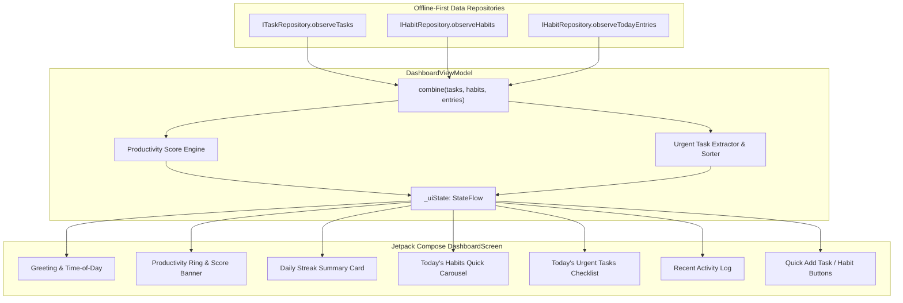

# Dashboard Implementation & Productivity Architecture

## 1. Overview & Objectives

The native ARC Dashboard serves as the central command center for the personal operating system. It brings together tasks, habits, and user productivity metrics into a unified, reactive, and offline-first interface.

In Phase 2, the Dashboard was completely ported from Flutter (`lib/views/dashboard/`) into Jetpack Compose and Kotlin Coroutines. The core objectives accomplished include:
- **Reactive Multi-Source Aggregation:** Continuously observing independent Room Flow streams from both `ITaskRepository` and `IHabitRepository`.
- **ARC Productivity Scoring Algorithm:** Deterministic, normalized 0–100 score reflecting daily task and habit completion rates.
- **Actionable UI Design:** Direct interaction points to complete habits, check off tasks, and initiate new items without leaving the dashboard.
- **Zero Polling / Event-Driven State:** Pure reactive updates via `combine(taskFlow, habitFlow)` ensuring instantaneous UI re-render on any local database write.

---

## 2. Architecture & Data Flow

---

## 3. Productivity Score Algorithm

The productivity score is computed deterministically in `DashboardViewModel` whenever tasks, habits, or completion entries change:

### Mathematical Specification:
1. **Task Completion Rate ($R_t$):**
   $$R_t = \begin{cases} 
   1.0 & \text{if } \text{TotalTasksToday} = 0 \text{ and } \text{TotalCompletedToday} > 0 \\
   0.0 & \text{if } \text{TotalTasksToday} = 0 \\
   \frac{\text{CompletedTasksToday}}{\text{TotalTasksToday}} & \text{otherwise}
   \end{cases}$$
   Where $R_t$ is clamped to $[0.0, 1.0]$.

2. **Habit Completion Rate ($R_h$):**
   $$R_h = \begin{cases}
   1.0 & \text{if } \text{TotalScheduledHabits} = 0 \text{ and } \text{CompletedHabitsToday} > 0 \\
   0.0 & \text{if } \text{TotalScheduledHabits} = 0 \\
   \frac{\text{CompletedHabitsToday}}{\text{TotalScheduledHabits}} & \text{otherwise}
   \end{cases}$$
   Where $R_h$ is clamped to $[0.0, 1.0]$.

3. **Composite Score ($S$):**
   $$S = \text{round}\left((R_t \times 50.0) + (R_h \times 50.0)\right)$$
   Yielding an integer scale of $0 \le S \le 100$.

### Tier Categories:
- **$80 \le S \le 100$:** Supercharged (Emerald accent)
- **$50 \le S < 80$:** On Track (Indigo accent)
- **$25 \le S < 50$:** Building Momentum (Amber accent)
- **$0 \le S < 25$:** Getting Started (Muted / Slate accent)

---

## 4. UI Layout & Component Breakdown

### 4.1 Header & Greeting
- Greets the authenticated user with personalized name (e.g., "Welcome back, Shreyas").
- Dynamically derives time of day greeting: "Good morning", "Good afternoon", or "Good evening".
- Displays today's formatted date string (e.g., "Sunday, October 18, 2026").

### 4.2 Score Banner & Progress Ring
- Large animated circular progress ring visualizing composite score $S$.
- Dual breakdown chips showing `Tasks: X/Y` and `Habits: A/B`.
- Contextual motivational subtitle based on the score tier.

### 4.3 Today's Habits Quick-Actions Row
- Horizontally scrollable row displaying all active habits scheduled for today.
- Each item shows habit title, category color badge, and a circular toggle.
- Tapping immediately completes or uncompletes the habit in Room SQLite without navigating away.

### 4.4 Urgent Tasks Checklist
- Prioritized list of tasks due today or overdue.
- Sorted by priority (Must/High first) and due time.
- Direct checkbox toggle allowing immediate task completion from the dashboard.

### 4.5 Quick Action Shortcut Buttons
- Floating or embedded shortcut buttons to trigger `TaskEditorSheet` or `HabitEditorSheet` modal sheets directly from the dashboard.

---

## 5. Verification and Testing

The Dashboard is covered by thorough unit tests in `DashboardModuleTest.kt` (9 unit tests):
1. **`initialState_emitsEmptyOrInitialValues`**: Validates initial state before data flows emit.
2. **`tasksFlowUpdate_calculatesTodayTaskCountsCorrectly`**: Tests task count aggregation.
3. **`habitsFlowUpdate_calculatesHabitsProgressCorrectly`**: Tests habit completion aggregation.
4. **`productivityScore_calculatedDeterministically`**: Tests exact formula output for various completion rates.
5. **`quickToggleHabit_callsRepositoryToggle`**: Verifies habit toggle invocation from dashboard.
6. **`quickToggleTask_callsRepositoryToggle`**: Verifies task toggle invocation from dashboard.
7. **`urgentTasks_filteredAndSortedByPriority`**: Confirms priority ordering of dashboard task list.
8. **`userIsolation_onlyCurrentUserDataObserved`**: Ensures data from inactive users never enters dashboard state.
9. **`userMessage_displayedAndCleared`**: Validates snackbar/message dispatch and dismissal.
