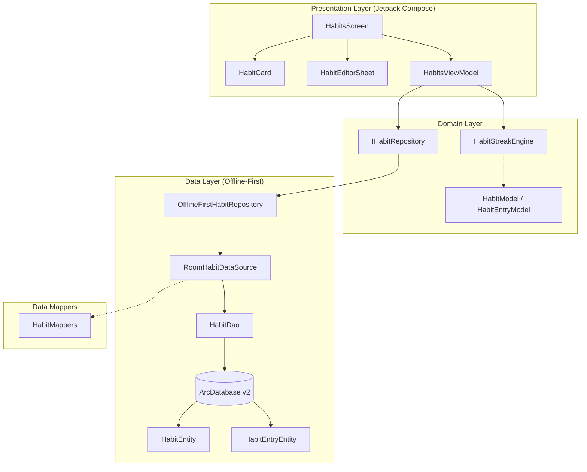

# Habits Implementation & Architecture Guide

## 1. Overview & Objectives

The Habit Tracker is a core pillar of ARC's offline-first personal operating system. In Phase 2, the Habit Tracker was ported from Flutter (`lib/views/habits/`, `lib/models/habit_model.dart`, `lib/models/habit_entry_model.dart`) into a modern, native Android architecture using Jetpack Compose, Material 3, Room SQLite persistence, and unidirectional data flow (UDF).

The key architectural requirements satisfied include:
- **100% Data Compatibility:** Full interoperability with the legacy Flutter data schema, preserving composite keys, date string formatting (`yyyy-MM-dd`), and habit configuration options.
- **Offline-First Persistence:** Reactive Room Flow queries, optimistic UI updates, and transactional atomicity.
- **Deterministic Progress & Streak Calculations:** Exact mathematical parity with Flutter's streak calculation algorithm, factoring in schedule frequencies and rolling 7-day completion windows.
- **Accessible, Native Material 3 UI:** Fluid animations, responsive bottom sheet editor, quick completion toggles, and zero deprecation warnings.

---

## 2. Architecture Diagram



---

## 3. Data Schema & Contracts

### 3.1 Habit Entity (`HabitEntity.java`)
The parent entity stored in table `habits`:
```sql
CREATE TABLE habits (
    id TEXT PRIMARY KEY NOT NULL,
    userId TEXT NOT NULL,
    title TEXT NOT NULL,
    description TEXT,
    category TEXT NOT NULL,
    colorHex TEXT,
    iconName TEXT,
    frequencyType TEXT NOT NULL,
    targetDaysJson TEXT NOT NULL,
    targetPerDay INTEGER NOT NULL,
    reminderTime TEXT,
    isArchived INTEGER NOT NULL,
    createdAt INTEGER NOT NULL,
    updatedAt INTEGER NOT NULL
);
CREATE INDEX index_habits_userId ON habits (userId);
```

### 3.2 Habit Entry Entity (`HabitEntryEntity.java`)
Individual daily completion records stored in table `habit_entries`:
```sql
CREATE TABLE habit_entries (
    id TEXT PRIMARY KEY NOT NULL,
    habitId TEXT NOT NULL,
    userId TEXT NOT NULL,
    dateStr TEXT NOT NULL,
    completedAt INTEGER NOT NULL,
    notes TEXT,
    value REAL NOT NULL
);
CREATE INDEX index_habit_entries_habitId ON habit_entries (habitId);
CREATE INDEX index_habit_entries_userId ON habit_entries (userId);
CREATE INDEX index_habit_entries_dateStr ON habit_entries (dateStr);
```

### 3.3 Composite Primary Key Contract
To prevent duplicate daily completion records while maintaining complete parity with Flutter's Hive/Firestore keying mechanism, `id` in `habit_entries` is explicitly formatted as:
$$\text{id} = \text{habitId} + \text{"\_"} + \text{dateStr}$$
Where `dateStr` is formatted as ISO-8601 Date (`yyyy-MM-dd`). Inserting a record for the same habit and same day performs an upsert or atomic replacement, guaranteeing idempotency.

---

## 4. Streak & Progress Engine (`HabitStreakEngine.kt`)

Streak calculation is deterministic and purely functional:
- **Input:** Target `HabitModel`, sorted list of `HabitEntryModel` completions, and a reference evaluation `LocalDate` (defaults to `LocalDate.now()`).
- **Schedule Awareness:** If a habit only runs on specific days (e.g., Monday through Friday), non-scheduled days do not penalize or break the streak.
- **Current Streak Calculation:**
  1. Checks if today is completed. If completed, start streak at 1 and check backward day by day.
  2. If today is not completed, checks if yesterday was completed. If yes, starts streak from yesterday (since today is still in progress).
  3. Steps backward day by day: for each scheduled day, increments streak if completed; terminates the loop at the first missing scheduled day.
- **Best Streak Calculation:**
  Evaluates all historical entries to find the maximum contiguous chain of completed scheduled days.
- **Rolling 7-Day Completion Grid:**
  Computes a 7-element `List<Boolean>` representing the status from $(today - 6\text{ days})$ to $today$.

---

## 5. UI Presentation & Components

### 5.1 `HabitCard.kt`
- **Visual Design:** ARC Surface card with accent-colored left indicator.
- **Circular Toggle:** Quick one-tap completion toggle with animated fill and check icon.
- **7-Day Grid:** Horizontal row of 7 circular indicators displaying Day-of-Week abbreviation and colored fill status for the past week.
- **Metrics Badges:** Flame icon indicating current streak count, category tag, and reminder time.

### 5.2 `HabitEditorSheet.kt`
- Modal bottom sheet providing:
  - Habit title & optional description input fields.
  - Category selector (Health, Fitness, Learning, Productivity, Mind, Custom).
  - Target frequency day selector chips (Mon–Sun toggleable).
  - Color palette selection (Indigo, Emerald, Rose, Amber, Cyan, Purple).
  - Reminder time picker dialog using Compose Material 3 `TimePicker`.

### 5.3 `HabitsScreen.kt`
- Segmented category tabs for fast filtering.
- Header showing overall habit completion ring for today.
- Animated empty state when no habits match the current category.
- Search input for real-time title filtering.

---

## 6. Verification and Testing

The Habit Tracker is validated by multiple dedicated test suites:
- **`HabitContractTest.kt` (7 tests):** Validates legacy JSON serialization, composite key format, date parsing, and missing fields.
- **`HabitsPersistenceTest.kt` (5 tests):** Tests Room DAO queries, CRUD operations, cascade queries, and user isolation.
- **`HabitStreakEngineTest.kt` (11 tests):** Tests empty entries, single completions, contiguous streaks, weekend schedules, and broken streaks.
- **`HabitsModuleTest.kt` (9 tests):** Validates ViewModel state flows, category filtering, search, optimistic toggle, and creation flows.
- **`OfflineProductivityIntegrationTest.kt` (4 tests):** Tests multi-user isolation, cross-module flow updates, and offline sync readiness.
