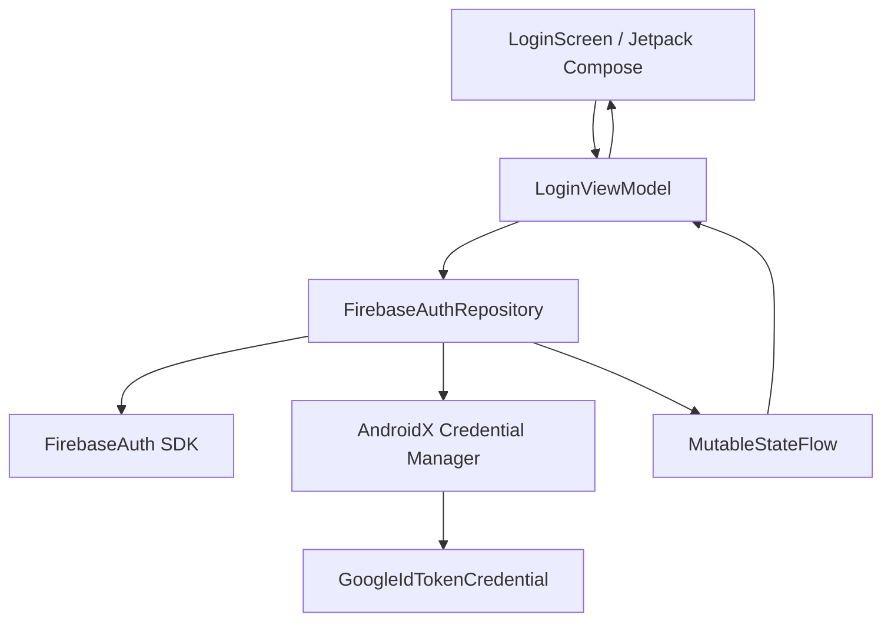

# Firebase Authentication Integration & Identity Architecture

## Overview

The native Android ARC authentication architecture replaces the legacy Flutter Firebase Auth bindings with a modern, reactive Kotlin implementation built on the AndroidX Credential Manager API and Firebase Authentication SDK (BoM 33.10.0).

This module delivers robust identity management, preserves user IDs across migration boundaries, enforces offline-first session caching, and provides clear separation between development test environments and production release builds.

---

## Architecture & Component Hierarchy



### Core Components

1. **[`ArcFirebaseConfig`](file:///C:/dev/ARC-Kotlin/app/src/main/java/com/arc/arc/core/auth/ArcFirebaseConfig.kt)**:
   - Holds centralized Firebase project configuration constants.
   - Project ID: `arc-productivity-shreyas`
   - Default Web Client ID: `729643761637-6l1cekc186jos6m6bdss0l0a6lhp9bfr.apps.googleusercontent.com` (from production `google-services.json`).
   - Package Name / Application ID: `com.arc.arc` (Production), `com.arc.arc.native.dev` (Development).

2. **[`IAuthRepository`](file:///C:/dev/ARC-Kotlin/app/src/main/java/com/arc/arc/core/auth/IAuthRepository.kt)**:
   - Interface defining reactive `authState: StateFlow<AuthState>`:
     - `AuthState.Unauthenticated`
     - `AuthState.Authenticated(user: User)`
     - `AuthState.Error(message: String)`
   - Asynchronous authentication methods:
     - `signInWithEmail(email, password)`
     - `signUpWithEmail(email, password)`
     - `sendPasswordResetEmail(email)`
     - `signInWithGoogleCredential(idToken)`
     - `signOut()`
     - `getCurrentUser(): User?`

3. **[`FirebaseAuthRepository`](file:///C:/dev/ARC-Kotlin/app/src/main/java/com/arc/arc/core/auth/FirebaseAuthRepository.kt)**:
   - Real Firebase Authentication repository implementation.
   - Synchronizes `FirebaseAuth.AuthStateListener` with coroutine-based `MutableStateFlow<AuthState>`.
   - Maps Firebase user objects to immutable domain `User` models (`id`, `email`, `displayName`, `photoUrl`).
   - Normalizes and maps Firebase exception codes (`ERROR_INVALID_CREDENTIAL`, `ERROR_USER_NOT_FOUND`, `ERROR_WRONG_PASSWORD`, `ERROR_EMAIL_ALREADY_IN_USE`) into friendly, secure user-facing error messages without disclosing sensitive enumeration vectors.

4. **[`DevFakeAuthRepository`](file:///C:/dev/ARC-Kotlin/app/src/main/java/com/arc/arc/core/auth/DevFakeAuthRepository.kt)**:
   - Development mock repository for rapid local testing without active network connectivity or Google Play Services dependencies.
   - Includes preset development accounts:
     - `dev_user_shreyas` (Shreyas Dev)
     - `dev_user_tester` (QA Tester)
     - `dev_user_offline` (Offline User)

---

## Credential Manager & Google Sign-In Flow

Legacy Google Sign-In (`GoogleSignInClient` / Google Play Services Auth) was deprecated in Android 14. ARC-Kotlin implements the modern AndroidX Credential Manager architecture (`androidx.credentials:credentials:1.3.0` + `com.google.android.libraries.identity.googleid:googleid:1.1.1`):

1. **Request Creation**:
   ```kotlin
   val googleIdOption = GetGoogleIdOption.Builder()
       .setFilterByAuthorizedAccounts(false)
       .setServerClientId(ArcFirebaseConfig.WEB_CLIENT_ID)
       .setAutoSelectEnabled(false)
       .build()

   val request = GetCredentialRequest.Builder()
       .addCredentialOption(googleIdOption)
       .build()
   ```

2. **Credential Extraction**:
   - `credentialManager.getCredential(context, request)` retrieves the user-selected Google Account.
   - Parsed via `GoogleIdTokenCredential.createFrom(customCredential.data)` to extract the secure ID token.

3. **Firebase Token Exchange**:
   - `GoogleAuthProvider.getCredential(idToken, null)` passes the cryptographic token to `FirebaseAuth.signInWithCredential()`.
   - Yields the authenticated Firebase `AuthResult` with persistent UID.

---

## User ID (UID) Preservation & Data Isolation

To prevent data collision and guarantee seamless migration from the legacy Flutter application:
- Firebase UIDs are preserved exactly as generated by Firebase Authentication.
- All Room SQLite database tables (`tasks`, `habits`, `habit_entries`, `transactions`, `budgets`) include the mandatory `owner_uid` foreign key column indexed for rapid per-user isolation.
- On account logout (`signOut()`), in-memory caches and active UI states are cleared immediately.
- Secret Notes vault metadata in `VaultPreferencesDataStore` partitions PIN hashes and PBKDF2 salts using user-scoped preference keys (`vault_salt_$ownerUid`, `vault_encrypted_dek_$ownerUid`).

---

## Development vs. Production Isolation

In [`AppContainer.kt`](file:///C:/dev/ARC-Kotlin/app/src/main/java/com/arc/arc/core/di/AppContainer.kt):
- If `BuildConfig.DEBUG` is active and Firebase services are uninitialized, the application falls back safely to `DevFakeAuthRepository`.
- In release builds (`BuildConfig.DEBUG == false`):
  - `LoginScreen` disables and hides the development preset dropdown (`DevQuickLoginSection`).
  - Strict Firebase Authentication is mandated.
  - Zero mock credentials can be used in release APK or AAB variants.

---

## Automated Verification & Test Coverage

The authentication module is validated through 7 comprehensive unit tests in [`FirebaseAuthTest.kt`](file:///C:/dev/ARC-Kotlin/app/src/test/java/com/arc/arc/auth/FirebaseAuthTest.kt):

| Test Case | Description | Result |
| :--- | :--- | :--- |
| `testInitialStateIsUnauthenticated` | Verifies default state before any login call | PASS |
| `testSignInWithValidPreset` | Validates preset dev user sign-in and state emission | PASS |
| `testSignInWithInvalidEmailThrowsError` | Asserts email regex validation rejects malformed addresses | PASS |
| `testSignOutResetsStateToUnauthenticated` | Verifies session teardown resets state to Unauthenticated | PASS |
| `testSignUpWithNewEmailSuccess` | Validates new user registration and UID generation | PASS |
| `testPasswordResetSuccess` | Verifies password reset trigger and status | PASS |
| `testGoogleCredentialSignInSuccess` | Asserts Google ID token processing and authentication | PASS |

All tests execute in 100% offline JVM environments without network or hardware dependencies.
