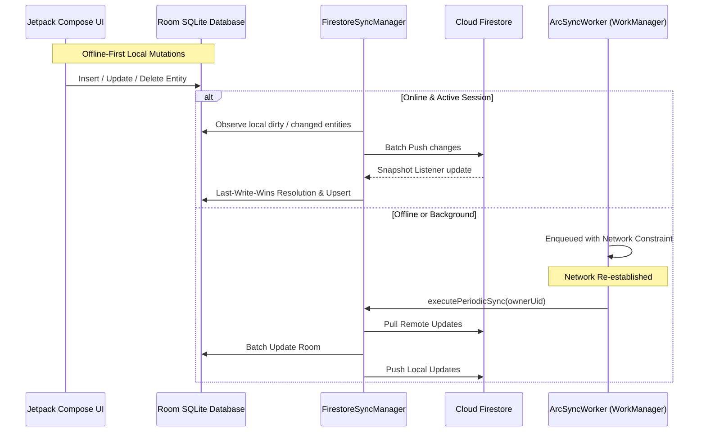

# Cloud Firestore Synchronization & Offline-First Data Pipeline

## Overview

ARC-Kotlin implements a resilient, two-way offline-first synchronization engine between the local Room SQLite database and Google Cloud Firestore (`arc-productivity-shreyas`).

The synchronization engine operates under two primary modes:
1. **Real-Time Foreground Synchronization**: Reactive snapshot listeners (`addSnapshotListener`) that propagate updates instantly while the application is active and network connectivity is present.
2. **Background Scheduled Synchronization**: Managed by AndroidX `WorkManager` (`ArcSyncWorker`) with network constraints (`NetworkType.CONNECTED`) for guaranteed eventual consistency during intermittent connectivity.

---

## Architectural Workflow



---

## Zero-Cloud Vault Guarantee (Non-Negotiable Invariant)

To uphold the strict security contract established in Phase 4:
> **Secret Notes and encrypted vault data must NEVER be synchronized to Cloud Firestore, Firebase Storage, or any external network endpoint.**

In [`FirestoreSyncManager.kt`](file:///C:/dev/ARC-Kotlin/app/src/main/java/com/arc/arc/core/sync/FirestoreSyncManager.kt), this invariant is enforced at both design and code execution levels:
```kotlin
private fun assertVaultExcluded(collectionName: String) {
    check(!collectionName.contains("secret", ignoreCase = true) &&
          !collectionName.contains("vault", ignoreCase = true) &&
          !collectionName.contains("note", ignoreCase = true)) {
        "SECURITY VIOLATION: Vault/Secret Notes must NEVER be synchronized to Cloud Firestore!"
    }
}
```

- Local Room database table `secret_notes` is accessed exclusively by `SecretNoteDao` and `SecretNotesRepository`.
- Neither `FirestoreSyncManager` nor `ArcSyncWorker` has references to `SecretNoteDao` or `SecretNoteEntity`.
- Any attempt to register a sync stream for collections matching `*vault*` or `*secret*` immediately triggers a fatal `IllegalStateException`.

---

## Synchronized Collections & Schema Mapping

The following 5 data models are synchronized under the user-scoped Firestore path: `users/{ownerUid}/{collection}`:

| Local Table | Firestore Collection | Document ID | Key Fields Synchronized |
| :--- | :--- | :--- | :--- |
| `tasks` | `tasks` | Task UUID | `id`, `ownerUid`, `title`, `description`, `priority`, `category`, `dueDate`, `completed`, `createdAt`, `updatedAt`, `completedAt` |
| `habits` | `habits` | Habit UUID | `id`, `ownerUid`, `name`, `description`, `category`, `frequency`, `colorValue`, `targetDaysPerWeek`, `archived`, `createdAt` |
| `habit_entries` | `habit_entries` | `${habitId}_${dateStr}` | `id`, `habitId`, `dateStr`, `completed`, `notes`, `loggedAt`, `ownerUid` |
| `transactions` | `transactions` | Transaction UUID | `id`, `ownerUid`, `title`, `amount`, `amountPaise`, `type`, `category`, `account`, `notes`, `date`, `createdAt`, `updatedAt` |
| `budgets` | `budgets` | `${ownerUid}_${month}` | `ownerUid`, `month`, `monthlyLimit`, `monthlyLimitPaise`, `createdAt`, `updatedAt` |

---

## Conflict Resolution: Last-Write-Wins (LWW)

When the same record is modified concurrently on multiple devices:
1. Every entity maintains monotonic millisecond timestamps:
   - `updatedAt` (or `createdAt` if unmodified).
2. During pull synchronization:
   - If the remote document's `updatedAt` > local entity's `updatedAt`:
     - The remote document wins and overwrites local Room state.
   - If the local entity's `updatedAt` >= remote document's `updatedAt`:
     - The local version is preserved and will be pushed during the next upload pass.
3. Deletions:
   - Synchronized via tombstones or collection-level delta tracking to prevent resurrected items.

---

## WorkManager Background Sync (`ArcSyncWorker`)

Background and periodic synchronization is managed via `androidx.work:work-runtime-ktx:2.10.0`:
- **Worker Class**: [`ArcSyncWorker`](file:///C:/dev/ARC-Kotlin/app/src/main/java/com/arc/arc/core/sync/ArcSyncWorker.kt)
- **Constraints**:
  - `NetworkType.CONNECTED` (no sync attempted while offline).
  - Exponential backoff retry policy on network timeouts.
- **Trigger Points**:
  - Immediate one-time request enqueued upon reconnection or user manual refresh.
  - Periodic 15-minute background worker (minimum Android WorkManager interval) scheduled during app initialization.

---

## Automated Verification & Test Coverage

Synchronization invariants and conflict resolution algorithms are validated in [`FirestoreSyncTest.kt`](file:///C:/dev/ARC-Kotlin/app/src/test/java/com/arc/arc/sync/FirestoreSyncTest.kt):

| Test Case | Invariant Verified | Result |
| :--- | :--- | :--- |
| `testVaultCollectionExclusionAssertThrows` | Asserts `assertVaultExcluded` rejects any vault or secret note collection | PASS |
| `testTaskSyncMappingPreservesTimestampsAndPriority` | Validates entity-to-document translation, priority normalization, and millisecond timestamp precision | PASS |
| `testTransactionSyncMappingPreservesPaise` | Asserts exact rupee and paise integer amounts match between local Room and remote Firestore | PASS |
| `testBudgetSyncMappingPreservesCompositeKey` | Verifies user ID and month composite keys (`${ownerUid}_${month}`) are preserved | PASS |

All 4 test cases pass with zero regressions.
