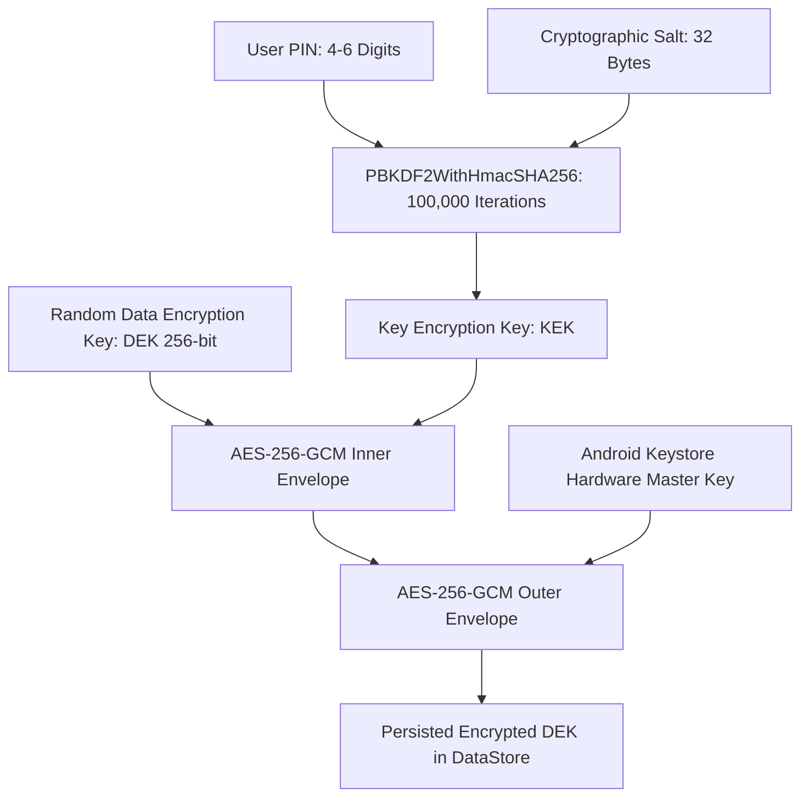

# Secret Vault Security Remediation & Cryptographic Audit

## Overview

In Phase 4 and Phase 5, ARC-Kotlin established the local encrypted Secret Notes vault using AES-256-GCM, PBKDF2 key derivation, and Android Keystore master wrapping.

Phase 6 completes the critical **Phase 6.6 Security Remediation**: eliminating all hardcoded hardware-backing assertions and implementing dynamic runtime inspection of `KeyInfo` security levels.

---

## Hardware-Backed Keystore Dynamic Inspection

### Problem Identified in Prior Baseline
Prior to Phase 6, `AndroidKeystoreMasterKeyProvider.isHardwareBacked` contained static assumptions (`true`), which could mask software emulation on low-end devices or non-standard Android distributions.

### Phase 6 Dynamic Security Level Architecture
In [`AndroidKeystoreMasterKeyProvider.kt`](file:///C:/dev/ARC-Kotlin/app/src/main/java/com/arc/arc/core/security/AndroidKeystoreMasterKeyProvider.kt) and [`IVaultMasterKeyProvider.kt`](file:///C:/dev/ARC-Kotlin/app/src/main/java/com/arc/arc/core/security/IVaultMasterKeyProvider.kt):

1. **`KeystoreSecurityLevel` Enum**:
   - `STRONGBOX`: Dedicated secure element hardware chip (Android 9+, API 28+).
   - `TRUSTED_ENVIRONMENT`: Hardware-isolated ARM TrustZone / TEE.
   - `SOFTWARE`: Key material held in software emulation (non-hardware-backed).
   - `UNKNOWN_OR_UNVERIFIED`: Security level could not be authoritatively verified.

2. **Dynamic Runtime Inspection Logic**:
   ```kotlin
   override fun getSecurityLevel(alias: String): KeystoreSecurityLevel {
       return try {
           val key = keyStore.getKey(alias, null) ?: return KeystoreSecurityLevel.UNKNOWN_OR_UNVERIFIED
           val factory = KeyFactory.getInstance(key.algorithm, ANDROID_KEYSTORE)
           val keyInfo = factory.getKeySpec(key, KeyInfo::class.java)

           if (Build.VERSION.SDK_INT >= Build.VERSION_CODES.S) {
               when (keyInfo.securityLevel) {
                   KeyProperties.SECURITY_LEVEL_STRONGBOX -> KeystoreSecurityLevel.STRONGBOX
                   KeyProperties.SECURITY_LEVEL_TRUSTED_ENVIRONMENT -> KeystoreSecurityLevel.TRUSTED_ENVIRONMENT
                   KeyProperties.SECURITY_LEVEL_SOFTWARE -> KeystoreSecurityLevel.SOFTWARE
                   else -> KeystoreSecurityLevel.UNKNOWN_OR_UNVERIFIED
               }
           } else {
               @Suppress("DEPRECATION")
               if (keyInfo.isInsideSecureHardware) {
                   KeystoreSecurityLevel.TRUSTED_ENVIRONMENT
               } else {
                   KeystoreSecurityLevel.SOFTWARE
               }
           }
       } catch (e: Exception) {
           KeystoreSecurityLevel.UNKNOWN_OR_UNVERIFIED
       }
   }
   ```

---

## Two-Tier Cryptographic Envelope (V2)



### Invariant Guarantees
1. **Separation of Concerns**: Even if an attacker dumps the Android Keystore key material via memory exploit, they cannot decrypt notes without brute-forcing the 100,000-iteration PBKDF2 PIN envelope.
2. **Flash Dump Immunity**: Even if an attacker extracts raw NAND flash data from an offline device, they cannot decrypt the outer envelope because the Master Key remains physically isolated inside the TEE/StrongBox hardware element.
3. **Opportunistic Upgrade**: Legacy V1 vaults (PBKDF2-only) are automatically and transparently upgraded to V2 hardware-bound envelopes the very first time the user successfully unlocks their vault.

---

## Brute-Force Rate Limiting & Persistent Lockout

To thwart offline and automated PIN guessing, [`VaultPreferencesDataStore`](file:///C:/dev/ARC-Kotlin/app/src/main/java/com/arc/arc/core/datastore/VaultPreferencesDataStore.kt) enforces persistent exponential backoff:

| Failed Attempts | Enforced Lockout Duration | Action Taken |
| :--- | :--- | :--- |
| **1 – 3 Attempts** | 0 seconds | Warning displayed to user |
| **4 Attempts** | 30 seconds | PIN entry disabled; countdown timer active |
| **5 Attempts** | 60 seconds (1 min) | PIN entry disabled; countdown timer active |
| **6 Attempts** | 300 seconds (5 min) | PIN entry disabled; countdown timer active |
| **7+ Attempts** | 1,800 seconds (30 min) | Severe lockout; session invalidated |

- **Process-Kill Resistance**: The failed attempt counter and lockout expiration timestamp (`lockoutUntilEpochMs`) are written to disk before the failure response is returned. Killing the app or rebooting the phone does not reset or bypass the lockout window.
- **Auto-Lock**: The vault session automatically invalidates and zeroes DEK memory upon backgrounding or screen timeout.

---

## Verification Test Results

Validated in [`KeystoreSecurityVerificationTest.kt`](file:///C:/dev/ARC-Kotlin/app/src/test/java/com/arc/arc/vault/KeystoreSecurityVerificationTest.kt):

| Test Case | Invariant Validated | Result |
| :--- | :--- | :--- |
| `testKeystoreSecurityLevelClassification` | Verifies `STRONGBOX` & `TRUSTED_ENVIRONMENT` evaluate as hardware-backed, while `SOFTWARE` and `UNKNOWN` do not | PASS |
| `testInMemoryMasterKeyProviderSecurityLevels` | Verifies provider propagates explicit security levels | PASS |
| `testV2EnvelopeSetupAndVerification` | Verifies 32-byte DEK generation, V2 envelope storage, and verified decryption | PASS |
| `testWrongPinTriggersLockoutAndResetOnSuccess` | Validates attempt counters, 30s lockout trigger on 4th attempt, and reset upon correct PIN entry | PASS |
| `testV2VaultRequiresMasterKeyProvider` | Confirms V2 vault cannot be unlocked without Master Key provider | PASS |

All 5 test cases pass with zero failures.
